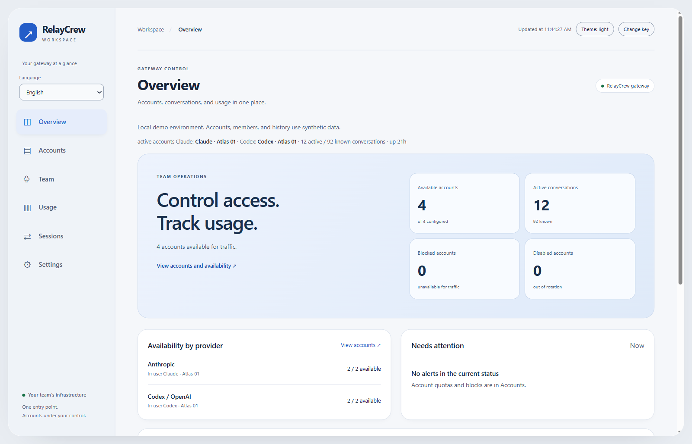

# RelayCrew

[](https://github.com/sep1ol/relaycrew/actions/workflows/ci.yml)
[](LICENSE)

Self-hosted gateway for Claude Code and Codex. Run one gateway on a VPS, keep provider credentials on the server, and issue each developer an individually revocable gateway key.

This community fork is maintained at [sep1ol/relaycrew](https://github.com/sep1ol/relaycrew). It retains the MIT license and history of [KarpelesLab/teamclaude](https://github.com/KarpelesLab/teamclaude). The upstream project targets individual use. This fork adds an explicit team access boundary.

<picture>
  <source media="(prefers-color-scheme: dark)" srcset="docs/assets/screenshots/overview-dark.png">
  <source media="(prefers-color-scheme: light)" srcset="docs/assets/screenshots/overview-light.png">
  
</picture>

[Read the documentation](docs/README.md) · [Deploy on a VPS](docs/teams.md) · [Explore the dashboard](docs/04-dashboard/README.md) · [Contribute](CONTRIBUTING.md)

## Documentation

Follow the numbered guides from setup to daily use:

| Guide | Topic |
| --- | --- |
| [00 · Introduction](docs/00-introduction/README.md) | Gateway architecture, credentials, and scope |
| [01 · Installation](docs/01-installation/README.md) | Local preview, systemd, and Docker Compose |
| [02 · Provider accounts](docs/02-provider-accounts/README.md) | Claude, Codex, and API-key login |
| [03 · Developer setup](docs/03-developer-setup/README.md) | Member keys and remote client configuration |
| [04 · Dashboard tour](docs/04-dashboard/README.md) | Screenshots and administrative workflows |
| [05 · Daily operations](docs/05-operations/README.md) | Monitoring, access, backups, and upgrades |
| [06 · Contribute](docs/06-contributing/README.md) | Issues, documentation, tests, and pull requests |
| [07 · Reference](docs/07-reference/README.md) | Configuration, routing, quotas, and API contracts |

## What team mode provides

- Individual member keys with creation, rotation, revocation, and usage attribution.
- Account permissions based on stable IDs, including overlapping account pools.
- Load-based placement of new conversations across eligible accounts, with account affinity for cache reuse and quota-driven failover.
- Administrator-only fleet status, configuration controls, and management MCP.
- Private member usage at `GET /relaycrew/me`.
- Per-member concurrent request limits covering retries and streaming.
- Credential revalidation inside existing MITM tunnels.
- Persistent provider credentials and usage through the existing protected configuration and state files.

Existing individual configurations retain their routing settings. Team mode requires explicit activation. Codex support inherits upstream's experimental status. Use provider credentials and account arrangements authorized for your organization. A software fork does not change provider subscription terms or increase an account's quota.

## Install from source

Node.js 20 or newer is required. No runtime dependencies are needed.

```sh
git clone https://github.com/sep1ol/relaycrew.git
cd relaycrew
git switch main
node src/index.js team init
node src/index.js login --claude
node src/index.js team accounts
node src/index.js team add alice --accounts '<account-id>' --max-concurrent 4
node src/index.js server --headless
```

Run `login` once for each provider account. Choose `--claude` for a Claude subscription, `--codex` for a ChatGPT/Codex subscription, `--claude-api` for an Anthropic API key, or `--openai-api` for an OpenAI API key. OpenAI API keys serve Responses requests. See [accounts](docs/accounts.md). Member keys are printed only when created or rotated. Store and distribute them through a private channel.

New configurations enable load-based conversation distribution. For a shared pool, grant each member the pool's account IDs and keep those accounts at equal priority. Existing installations can opt in with `node src/index.js distribute load`. See [sharing accounts](docs/05-operations/README.md#spread-work-across-accounts) for setup and limits.

The administrator key stays in the configuration file and is never printed by `team init`. Keep the file private. Do not give developers the server configuration or provider OAuth tokens.

To grant a member every configured account, including future additions, use an explicit wildcard.

```sh
node src/index.js team add bob --accounts '*' --max-concurrent 2
node src/index.js team list
node src/index.js team rotate alice
node src/index.js team revoke bob
```

Changes notify the local server. If a reload fails, the command reports that a restart is required. See [team operations](docs/teams.md) for installation on a VPS and client configuration.

## Dashboard

The [visual tour](docs/04-dashboard/README.md) includes screenshots of both themes, account controls, team access, and usage distributions. Run `npm run preview` to explore an isolated demonstration with synthetic data.

Open `/relaycrew/dashboard` on the gateway or run `node src/index.js dashboard`. The workspace includes accounts, team management, sessions, settings and historical usage distributions. Team controls use the administrator key; member keys cannot view fleet data. See the [dashboard guide](docs/dashboard.md) for operation, API contracts and historical coverage limits.

## Verify changes

```sh
npm install --ignore-scripts
npm test
npm run lint
npm run typecheck
npm run typecheck:strict -- --base <previous-commit>
```

Focused team checks use local fake providers and do not spend provider quota.

```sh
node --test test/team-access.test.js test/team-command.test.js
```

See the [architecture](docs/team-architecture.md), [verification record](docs/team-verification.md), and [decision trail](docs/team-decisions.tsv). The original feature reference is preserved in [UPSTREAM.md](UPSTREAM.md).

## Deployment limits

Run one gateway replica. Member concurrency is enforced per process. Usage statistics persist through the existing state file; concurrency counters restart with the process.

Members can use pooled HTTP inference, directly or inside managed MITM tunnels. Arbitrary forwarding, Remote Control, and WebSocket relays are administrator-only. Team mode disables the implicit localhost trust exemption. The static dashboard HTML remains public; its fleet data requires the administrator key.

The CLI command is `relaycrew` and package metadata uses `@sep1ol/relaycrew`. Legacy `teamclaude` and `teamrouter` commands and configuration inputs remain supported. See the [migration notes](docs/brand-migration.md). This repository does not claim an npm release. Install from source or build the included Dockerfile. Automatic npm publishing requires a manually triggered workflow and publisher configuration.

## Contribute

Start with the [contribution guide](CONTRIBUTING.md). Documentation fixes, bug reproductions, compatibility reports, tests, and code reviews all help. Look for [good first issues](https://github.com/sep1ol/relaycrew/labels/good%20first%20issue) or [help wanted](https://github.com/sep1ol/relaycrew/labels/help%20wanted).

Use [Discussions](https://github.com/sep1ol/relaycrew/discussions) for questions and early ideas. The [support guide](SUPPORT.md) explains where to report problems. Pull requests use the repository template and require review and CI. See the [maintainer process](MAINTAINERS.md) and [code of conduct](CODE_OF_CONDUCT.md).
