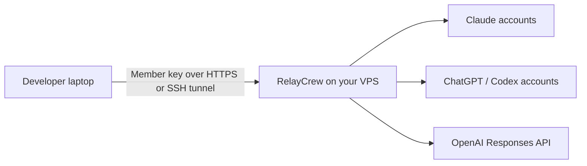

# 00 · Introduction

RelayCrew is a self-hosted team gateway for Claude Code and Codex. Run one gateway on a VPS, connect provider accounts, and give each developer an individual gateway key.

Developers run their coding tools locally. RelayCrew checks their account grants and concurrent request limit, then forwards model requests using a permitted provider account. The gateway stores provider credentials on the server.

## Know the credentials

| Credential | Who uses it | Where it belongs |
| --- | --- | --- |
| Administrator key | Gateway administrator | Protected server configuration and administrator browser |
| Member key | One developer or automation | That member's client environment |
| Provider credential | RelayCrew | Private server configuration |

The administrator dashboard shows accounts, member access, usage distributions, sessions, and operational controls. Members cannot inspect fleet data or manage other members.

## Check the current scope

Use one gateway replica. Member concurrency is enforced per process. Historical charts retain the last 24 hours of recorded activity. Account quotas still come from the providers.

Claude and ChatGPT subscription authorization currently runs through the CLI. Dashboard account onboarding is tracked in [issue #3](https://github.com/sep1ol/relaycrew/issues/3). Codex subscription integration is experimental. Native OpenAI API-key support covers HTTP Responses and compaction with an explicit model.

For the complete account and transport behavior, see [accounts](../accounts.md) and [proxy modes](../proxy-modes.md).

---

[Documentation index](../README.md) · [Next · Installation](../01-installation/README.md)
