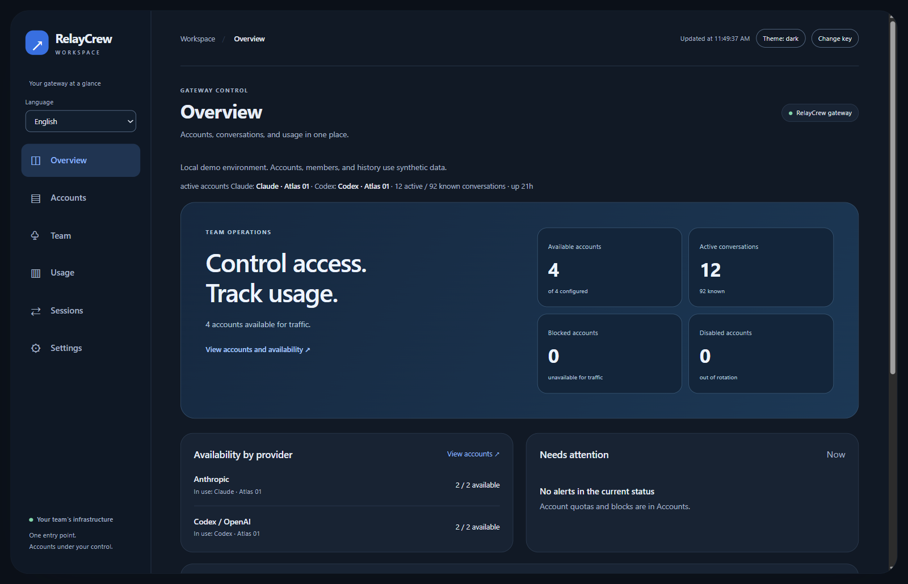
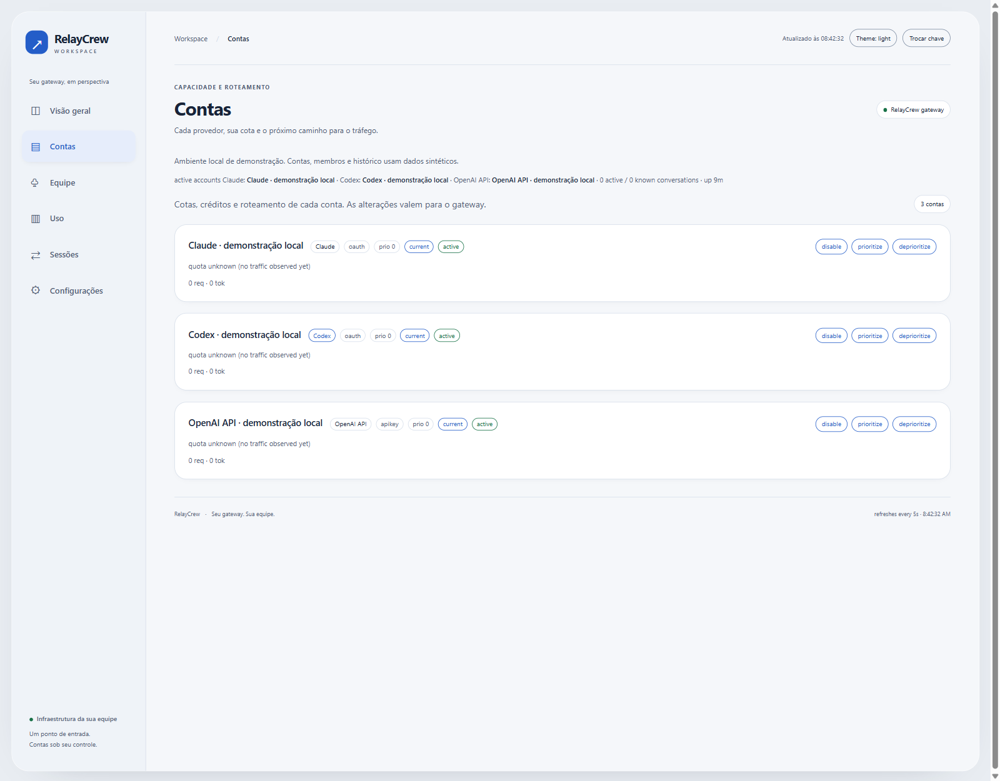
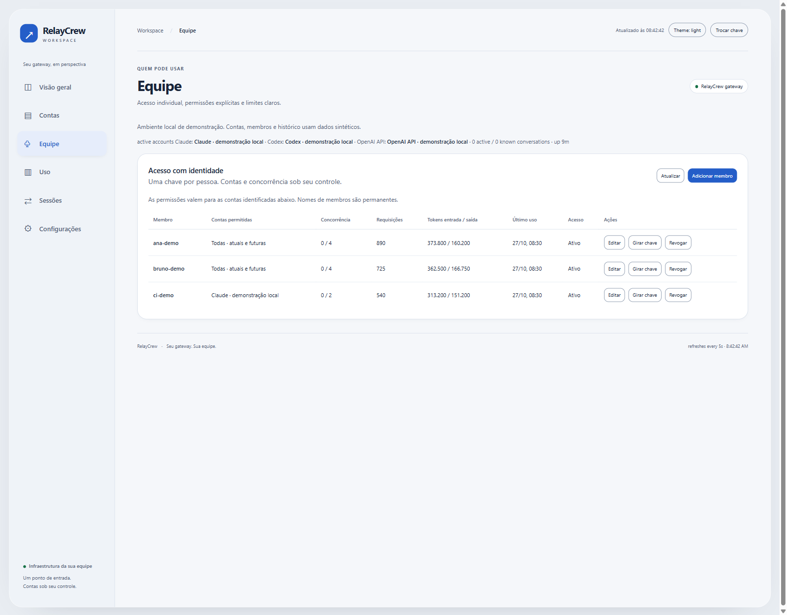
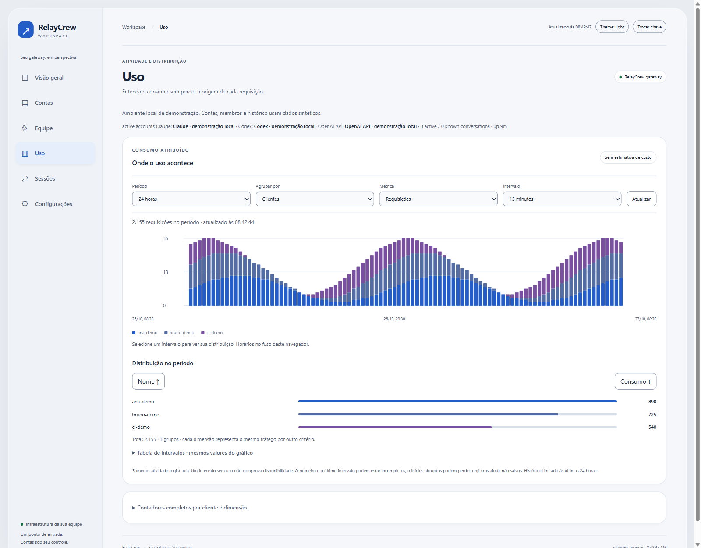

# 04 · Dashboard tour

Open `/dashboard` on your gateway and sign in with the administrator key. The following screenshots show the local preview with synthetic accounts, members, and history. English is the default interface language. Use the language selector to switch to Portuguese (Brazil) or Spanish. The choice stays in this browser for this gateway. The screenshots below use English.

## Overview

Overview shows account availability, active conversations, provider pools, operational alerts, and recent activity. Follow a provider to Accounts or open Usage for the historical breakdown.

The theme control cycles through system, light, and dark. Charts and form controls follow the selected palette. The workspace stays inside the viewport with padding around it. Scroll the main content pane to reach the rest of a view; the sidebar stays in place.

## Accounts

Accounts shows existing provider accounts, status, quota information when available, and routing controls. You can enable or disable accounts, change priority, and choose an active account. A missing quota reading is not a zero-usage reading.

Connect or reconnect providers through the CLI as described in [provider accounts](../02-provider-accounts/README.md). Browser account onboarding is tracked in [issue #3](https://github.com/sep1ol/relaycrew/issues/3).

## Team

Team lets you create members, select account grants, set concurrency, rotate keys, and revoke access. Key creation and rotation reveal a key once. Normal listings omit credentials.

After an account is added, update explicit grants for members who need it. A wildcard grant already covers future accounts. Refresh a stale draft before saving when another administrator changed the team.

## Usage

Usage shows distribution over time and totals by member or configured dimension. Choose the period, metric, grouping, and interval. Select a chart bucket to inspect its distribution, or open the interval table for the same values.

Click a legend color to choose a different color for that member or group. The choice is saved in this browser for this gateway and follows the same identity across chart order, periods, metrics, and views. Custom colors apply to both themes. Use the reset control to return to the default palette.

History is limited to the last 24 hours. Missing activity does not prove uptime, and dimension totals describe the same traffic from different perspectives. Do not add those perspectives together or treat the chart as a bill.

## Sessions and settings

Sessions shows conversation details when enabled and lets administrators pin sessions to accounts. Provider and member-grant checks still apply to a pin.

Settings provides configuration reload, quota probes, the account-switch threshold, and current routing information. Advanced provider and routing settings remain in the server configuration file.

See the [dashboard reference](../dashboard.md) for update behavior, administrative endpoints, concurrency conflicts, and history coverage. See [screenshot maintenance](../assets/screenshots/README.md) to refresh these images.

---

[Previous · Developer Setup](../03-developer-setup/README.md) · [Documentation index](../README.md) · [Next · Operations](../05-operations/README.md)
